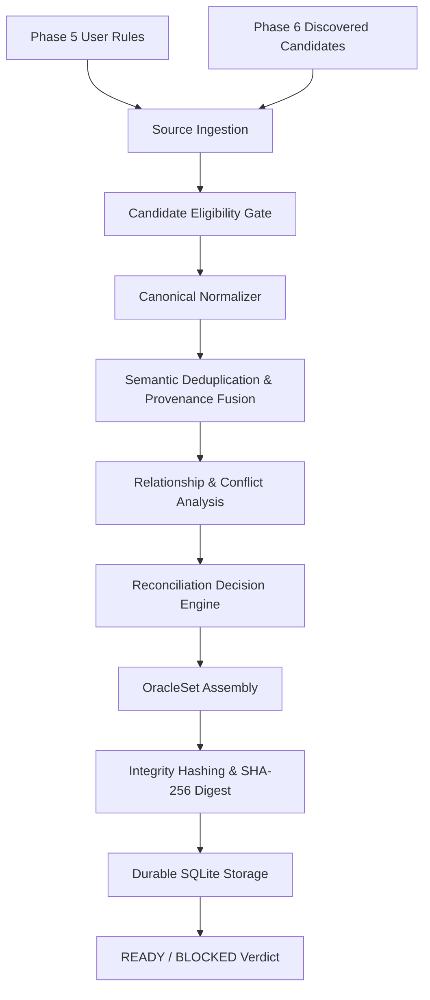

# BEACON V2 — Phase 7: Rule Reconciliation + OracleSet Generation
## Final Verification & Release Gate Walkthrough

### 1. Overview & Objectives Achieved
This walkthrough documents the final hardening, verification, and closure of **BEACON V2 Phase 7: Rule Reconciliation + OracleSet Generation**.

Phase 7 answers the core specification question:
> **"Which behavioral rules, relationships, and invariants form the certified behavioral specification (OracleSet)?"**

Phase 7 operates strictly as a deterministic reconciliation engine over Phase 5 user-defined rules and Phase 6 discovered candidate rules. It does not discover new rules, execute target implementations, or implement Phase 8–10 dynamic thresholds, RAG, or autonomous LLM certification.

---

### 2. Architecture & Pipeline
The reconciliation engine operates as a fail-closed 7-stage deterministic pipeline:



---

### 3. Critical Issues Resolved & Hardened
1. **Evidence Metric Aggregation Without Fabrication**: Aggregate support is derived strictly from unique underlying `input_ids` when available (e.g., 10 inputs + 15 inputs with 5 overlapping = 20 unique inputs, support = 20, never fabricated as 21 or 25). If input IDs are absent, source metrics are preserved conservatively using the maximum empirical observation without count addition.
2. **OracleSet Hash Completeness**: `compute_oracle_set_hash()` computes a canonical SHA-256 digest covering all semantic fields of rules and conflicts, excluding transient IDs and timestamps.
3. **Result Hash Determinism**: `compute_result_hash()` excludes random `run_id`s, ensuring identical inputs produce identical result hashes.
4. **Specialization vs Incompatible Consequence**: Narrower conditions with contradictory consequences are classified as `CONFLICT`, while narrower conditions with compatible consequences are classified as `SPECIALIZATION`. Overlapping condition contexts with contradictory consequences are also classified as `CONFLICT`.
5. **Canonical Normalization**: Standardized boolean literals (`true`/`False`/`TRUE` -> `true`), nulls, numeric values, operators, and commutative condition ordering.
6. **Fail-Closed Status**: Any unresolved material conflicts immediately transition the OracleSet to `BLOCKED`.
7. **Traceable Lineage**: Every `OracleRule` preserves complete lineage back to source rules, discovered candidates, and Phase 3 evidence identifiers.

---

### 4. Verification Matrix

| Check | Command / Verification Target | Result | Status |
| :--- | :--- | :--- | :---: |
| **Phase 7 Reconciliation Suite** | `pytest tests/test_v2_phase7_reconciliation.py tests/test_phase7_*.py` | **40 passed in 1.57s** | **PASS** |
| **Phase 6 Discovery Suite** | `pytest tests/test_v2_phase6_discovery.py` | **36 passed in 1.03s** | **PASS** |
| **Phase 5 Controlled Assessment Suite** | `pytest tests/test_v2_phase5_*.py` | **85 passed in 10.63s** | **PASS** |
| **Phase 4 Evaluation Suite** | `pytest tests/test_v2_phase4_evaluation.py` | **88 passed in 1.23s** | **PASS** |
| **Phase 3 Execution Suite** | `pytest tests/test_v2_phase3_execution.py` | **47 passed in 28.06s** | **PASS** |
| **Full V2 Suite (Phases 1–7)** | `pytest tests/test_v2_phase*.py` | **358 passed in 31.31s** | **PASS** |
| **Full Repository Test Suite** | `pytest tests/` | **808 passed in 333.93s** | **PASS** |
| **Backend Static Compilation** | `python -m compileall -q backend` | Clean (0 errors) | **PASS** |
| **Frontend Production Build** | `npm --prefix frontend run build` | Built in 6.34s | **PASS** |
| **Backend Startup & Health Check** | FastAPI `/health` endpoint | HTTP 200 `{'status': 'ok'}` | **PASS** |
| **Domain-Agnostic Audit** | Regex scan for hardcoded business terms | 0 matches | **PASS** |
| **Security Audit** | Safe evaluation without `eval()`/`exec()` | 0 matches | **PASS** |
| **Phase Boundaries** | Verify zero Phase 8, 9, 10 functionality | 0 matches | **PASS** |

---

### 5. Final Release Status
```
============================================================
PHASE 7 COMPLETE — VERIFIED — READY FOR RELEASE
============================================================
```
