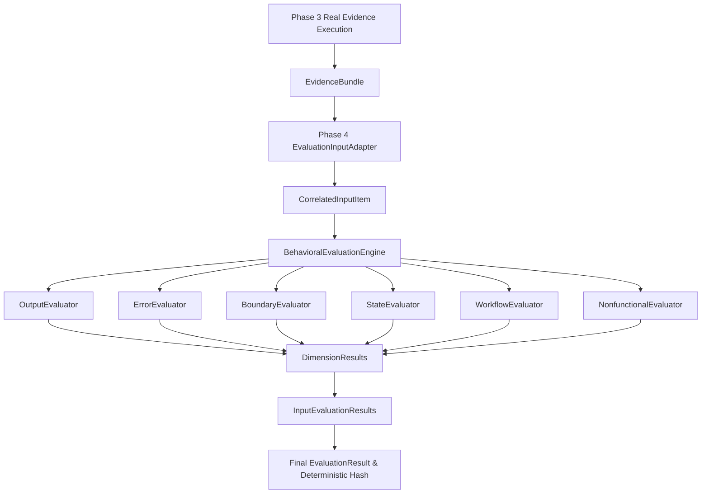

# BEACON V2 — Phase 4: Domain-Agnostic Behavioral Evaluation Engine
## Final Certification & Release Gate Walkthrough

### 1. Overview & Objectives Achieved
This walkthrough documents the final remediation and completion of **BEACON V2 Phase 4: Domain-Agnostic Behavioral Evaluation Engine**.

Phase 4 consumes tamper-evident execution evidence packages (`EvidenceBundle`) produced by Phase 3, correlates Reference and Target observations by canonical `input_id`, evaluates behavioral equivalence across six modular dimensions under declarative comparison policies, and generates deterministic, audit-ready evaluation certificates with cryptographic hashes and explicit difference attributions.

---

### 2. Architecture & Contract Integration
The end-to-end evaluation flow connects real Phase 3 evidence models to Phase 4 evaluators:

---

### 3. Core Evidence & Verdict Semantics
Strict distinction is maintained across all states:
- **`MISSING != EMPTY`**: Missing evidence yields `INCONCLUSIVE`, whereas an explicit empty record (`[]`, `{}`) is a valid observable state.
- **`MISSING != NULL`**: Missing output record yields `INCONCLUSIVE`, whereas explicit JSON null outputs yield `EQUIVALENT`.
- **`MISSING != ZERO`**: Missing row count yields `INCONCLUSIVE`, whereas `row_count = 0` is evaluated as an integer.
- **`MISSING != DIFFERENT`**: Missing side-effect or subsystem evidence on one side produces `INCONCLUSIVE` (EVIDENCE_MISSING), never a false `DIFFERENT` or false `EQUIVALENT`.

---

### 4. Comprehensive Dimension Coverage
1. **Output Evaluation**:
   - Deep recursive JSON/scalar comparison with object key invariance, explicit array order policy (`ordered` vs `unordered`), configurable absolute/relative numeric tolerances, and path-level difference attribution.
2. **Error Evaluation**:
   - Compares exit codes, HTTP statuses, structured error codes, categories, and messages. Distinguishes success/error mismatches (`DIFFERENT`) from insufficient error telemetry (`INCONCLUSIVE`).
3. **Boundary Evaluation**:
   - Evaluates behavior on boundary inputs classified by explicit metadata (`boundary_category`, `boundary_type`). Detects error divergence directly from HTTP status $\ge 400$ or exit codes without domain assumptions.
4. **State & Side-Effect Evaluation**:
   - Evaluates actual Phase 3 `DatabaseEvidence` (`configured_tables`, `table_row_counts_before`, `table_row_counts_after`, net deltas, `snapshot_before`, `snapshot_after`, `delta_detected`).
   - Evaluates actual Phase 3 `FileEvidence` (`before_state`, `after_state`, `FileStateSnapshot.sha256_hash`, `exists`, `size_bytes`, `created_files`, `modified_files`, `deleted_files`, `delta_detected`).
   - Evaluates actual Phase 3 `HttpEvidence` (`calls`, `method`, `url_or_endpoint`, `response_status`, `request_body`, `response_body`).
5. **Workflow & Sequence Evaluation**:
   - Evaluates trace lifecycle events under `exact` or `subsequence` modes. Distinguishes missing traces from empty traces.
6. **Nonfunctional Evaluation**:
   - Evaluates duration and latency ratios against fixed policy thresholds when enabled; returns `NOT_APPLICABLE` when disabled.

---

### 5. Verification Matrix
| Check | Command / Verification Target | Result | Status |
| :--- | :--- | :--- | :---: |
| **Phase 4 Evaluation Test Suite** | `pytest tests/test_v2_phase4_evaluation.py` | **88 passed in 0.69s** | **PASS** |
| **Phase 3 Execution Test Suite** | `pytest tests/test_v2_phase3_execution.py` | **47 passed in 19.53s** | **PASS** |
| **Backend Static Compilation** | `python -m compileall backend` | Clean (0 errors) | **PASS** |
| **API & Engine Startup Check** | `from backend.api.main import app` | Clean import | **PASS** |
| **Frontend Production Build** | `npm run build` | Built in 20.27s | **PASS** |
| **Domain-Agnostic Audit** | Regex scan for hardcoded business terms | 0 matches | **PASS** |
| **Phase Boundary Audit** | Scan for LLM/RAG/Oracles in evaluation | 0 matches | **PASS** |
